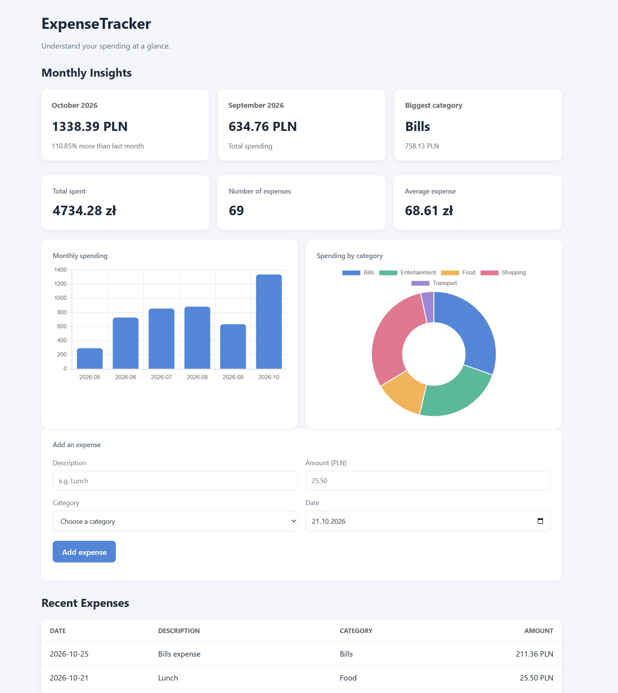

# ExpenseTracker

A personal expense tracking application built with Python, FastAPI, and SQLite. It combines expense management with interactive visualizations and monthly spending insights to make financial data easier to understand.



## Features

- **Expense management** — create, view, update, and delete expenses.
- **Dashboard** — view total spending, number of expenses, and average expense.
- **Interactive visualizations** — explore monthly spending trends and category breakdowns.
- **Monthly spending insights** — compare spending with the previous month and calculate percentage changes.
- **Category analysis** — identify the category with the highest spending in the current month.
- **Recent expenses** — view the latest transactions directly on the dashboard.
- **Automated tests** — verify database operations, API endpoints, analytics, and chart generation.

## Tech Stack

| Technology | Purpose |
|---|---|
| Python | Application logic and data analysis |
| FastAPI | REST API |
| SQLite | Persistent data storage |
| HTML & CSS | Dashboard structure and styling |
| JavaScript | Dashboard interactions and API integration |
| Chart.js | Interactive dashboard charts |
| Matplotlib | Python chart generation |
| Pytest | Automated testing |

## Getting Started

### Prerequisites

- Python 3.14 or newer
- pip

### Installation

Clone the repository and enter the project directory:

```bash
git clone <your-repository-url>
cd ExpenseTracker
```

Create and activate a virtual environment:

```bash
python -m venv .venv
source .venv/bin/activate
```

On Windows, activate it with:

```powershell
.venv\Scripts\Activate.ps1
```

Install the dependencies:

```bash
python -m pip install fastapi "uvicorn[standard]" pytest httpx matplotlib
```

### Run the application

Start the development server:

```bash
python -m uvicorn app.main:app --reload
```

Open the dashboard at:

http://127.0.0.1:8000

The interactive API documentation is available at:

http://127.0.0.1:8000/docs

## Dashboard

The dashboard brings expense tracking and analytics together in one interface.

It displays spending summaries, monthly and category charts, month-to-month comparisons, the largest spending category, and recent transactions. Expenses can be added through the dashboard, with the displayed statistics and charts refreshed after submission.

<!-- Add a screenshot of the dashboard here once one is saved in the repository. -->

## API Overview

| Method | Endpoint | Description |
|---|---|---|
| GET | `/expenses` | Retrieve expenses |
| GET | `/expenses/{expense_id}` | Retrieve an expense by ID |
| POST | `/expenses` | Create an expense |
| PUT | `/expenses/{expense_id}` | Update an expense |
| DELETE | `/expenses/{expense_id}` | Delete an expense |
| GET | `/expenses/summary` | Retrieve spending summary statistics |
| GET | `/expenses/by-category` | Retrieve spending totals by category |
| GET | `/expenses/by-month` | Retrieve monthly spending totals |
| GET | `/expenses/insights` | Compare monthly spending and identify the biggest category |

All endpoints can be explored through the interactive Swagger UI at `/docs`.

## Running Tests

Run the test suite from the project root:

```bash
python -m pytest -v
```

The tests cover database operations, API behavior, spending calculations, and visualization output.

## Project Structure

```text
ExpenseTracker/
├── app/
│   ├── __init__.py
│   ├── main.py
│   ├── database.py
│   ├── visualizations.py
│   └── static/
│       └── index.html
├── tests/
│   ├── test_main.py
│   ├── test_database.py
│   └── test_visualizations.py
├── .gitignore
└── README.md
```

- `app/main.py` — FastAPI application and API endpoints.
- `app/database.py` — SQLite database operations and spending analytics.
- `app/visualizations.py` — Python chart generation.
- `app/static/index.html` — interactive web dashboard.
- `tests/` — automated tests.

The SQLite database is created locally when the application initializes. Local database files should not be committed to version control.

## Future Improvements

- Filter analytics by a custom date range.
- Add configurable monthly budgets.
- Export expenses and reports to CSV.
- Improve dashboard accessibility and responsive design.

## License

This project is available under the MIT License.
